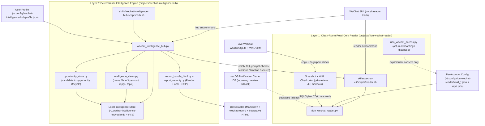

# WeChat Intelligence Hub 准入契约与架构规范

> 上级规则：
> - `~/.config/ai-instructions/AGENTS.md`（全局工程规则）
> - `~/Github_projects/AGENTS.md`（工作库根准入与领域矩阵）
> - `~/Github_projects/intelligence-pipelines/AGENTS.md`（自动化管道领域准入）

## 1. 定位与职责

`wechat-intelligence-hub` 是 `wechat` skill 的底层只读微信采集与确定性情报加工引擎（fork 自 `Rion-Wu-tech/wechat-intelligence-hub`）：

- **Layer 1（`projects/rion-wechat-reader/`）**：洁净室只读微信数据库读取器，通过临时快照 + WAL 检查点 + SQLCipher / Zstd 只读打开微信本地库，支持会话、时间线、检索、增量游标 `tail` 与通知中心降级读取。
- **Layer 2（`projects/wechat-intelligence-hub/`）**：本地确定性情报分析引擎，维护 `~/.wechat-intelligence-hub/radar.db`，产出群聊日报、人物上下文、待回复检查、主题聚合、商机雷达与经 `nh3` + CSP 净化的交互式 HTML 报告包。
- **严禁写微信**：本引擎只读本机微信数据，不发送消息、不操作微信 UI。

## 2. 架构总览



## 3. 权威文档与读取顺序

1. 本文件（架构图 SSOT、运行边界与验收入口）
2. [`README.md`](README.md)（项目总览与安装入口）
3. [`docs/USAGE.md`](docs/USAGE.md)（命令行参考）
4. [`projects/wechat-intelligence-hub/docs/architecture.md`](projects/wechat-intelligence-hub/docs/architecture.md)（Hub 内部设计）

## 4. 运行与验证

- Hub HTML 渲染与安全测试依赖 `projects/wechat-intelligence-hub/.venv/bin/python`（含 `nh3`）。
- Reader SQLCipher / Zstd 依赖由 `reader.sh` / `access.sh` 自动解析 `~/.local/share/rion-wechat-cli/venv/bin/python`。
- 验收命令：
  ```bash
  PYTHON_BIN=./projects/wechat-intelligence-hub/.venv/bin/python ./scripts/validate.sh
  ```
- 临时目录与构建产物清理一律移入 `~/.Trash/`，禁止提交个人配置、密钥、聊天导出与本地数据库。

<!-- BEGIN SCOPE-LIMITS-PROJECT (generated; edit rules/scope-limits-project.md) -->
## 防御预算（全局强约束）

- 同域缺陷主动修复：与当前任务同一子系统、调用链或影响面的问题（含存量缺陷），按根因第一性原理修到根因，不打补丁、不等指示；确认无关的才只报告。不堆防御。
- 校验只在四类信任边界做一次：公开 API、用户入口、配置/数据/网络解析出口、跨进程边界；边界内不重复判空 / 校验；安全 / 数据完整性纵深按项目要求做。
- 不吞错：禁止 `catch → null/false/空集合`、`log and continue`、用 `guest/0/{}/[]` 伪造默认值；只捕说得出名字且失败是正常业务路径的异常，其余抛到能处理的边界。
- 新增 guard / retry / fallback / cache / lock / 兼容层 / 抽象前，先答四问：真实失败、信任边界、失败后动作、测试或证据；缺一不写。第三方兜底注明「谁家问题 + 确切条件 + 何时可删」。
- 不做投机建设；哈希 / 校验和只在替代更贵操作且结果改变下一步时写；数据完整性 / 传输 / 去重所需校验和除外，但要有具名消费者；兼容只在有具名契约时保留（公开 API/CLI/配置/数据、已发布升级、安全边界、已观察生产状态），测试不是契约。
- 测试只为真实失败：用户要求、真实回归/边界/不变量、刚修的 bug、现有测试变红；不写镜像实现、不可能分支、实现细节、覆盖率表演。相关测试先跑，全量最多一轮放最后，验收即停；项目明确要求的测试门禁/契约测试优先；全量限制指本地重复跑，CI 门禁不受此限。
- 防御性代码与行为变化成比例：修 bug 通常几行；新增 >50 行防御性兜底先报「N 行 / M 行是校验兜底 / 不写的代价」。本条约束防御性代码与无关改动，不约束功能完备度、UI/UX、文档、测试或最佳实践所需的架构调整。
- 安全、隐私、鉴权、数据完整性、幂等、已发布迁移、必要调用方与测试、真实生产故障是任务本身，不因本条删掉；删防御前先问「删了会坏什么用户可观察行为？」。
- 项目明确要求的安全/迁移/发布门禁优先；纯范围扩张类项目规则（如「发现任何问题都必须修」）不在此列；安全/数据完整性纵深、易变外部模型/工具/平台的信任边界薄契约、测试隔离适配层与数据完整性校验不算投机建设。
- 「全局 / 架构 / 第一性原理 / 最佳实践 / 全面 / 不留尾巴」要求按最佳实践完整实现目标；范围控制只排除与目标无关的扩张，不削减功能、UI、文档、测试与可访问性。
- 倒金字塔信任与自解释代码：质量由确定性架构、静态类型与验证产物保证；业务层封禁隐式竞态与脆弱 API，清除 99% 不可执行注释；重复出现的纠错强制沉淀为物理级检查（架构/类型/lint/测试），严禁以自然语言重复交代。

完整判据与案例：`~/.config/ai-instructions/rules/scope-limits.md`；全局规则 §3.1。本块由 `~/.config/ai-instructions/rules/scope-limits-project.md` 生成，勿手改。
<!-- END SCOPE-LIMITS-PROJECT -->
