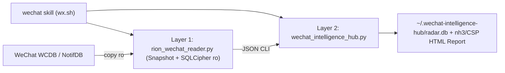

# WeChat Intelligence Hub

## 定位与架构

`wechat` skill 底层洁净室只读采集与确定性情报引擎（fork 自 `Rion-Wu-tech/wechat-intelligence-hub`，受 `[upstream-guard]` 保护）：
- **Layer 1 (`projects/rion-wechat-reader/`)**：临时快照 + WAL 检查点 + SQLCipher/Zstd `mode=ro` 只读微信库与通知中心降级读取。
- **Layer 2 (`projects/wechat-intelligence-hub/`)**：维护 `~/.wechat-intelligence-hub/radar.db`，产出群聊日报、人物上下文、待回复、商机雷达及 `nh3` + CSP 净化 HTML 报告。



## 硬约束

1. **只读与上游保护**：严禁发送微信消息或操作微信 UI；保留上游 `docs/` 与核心模块结构以便 `upstream` 合并，不提交个人配置、密钥、导出记录与本地数据库。
2. **环境与安全删除**：Hub 测试使用 `projects/wechat-intelligence-hub/.venv/bin/python`（含 `nh3`），Reader 自动解析 `~/.local/share/rion-wechat-cli/venv/bin/python`；清理临时产物一律 `mv` 至 `~/.Trash/`。

## 验收

```bash
PYTHON_BIN="$PWD/projects/wechat-intelligence-hub/.venv/bin/python" ./scripts/validate.sh
```
